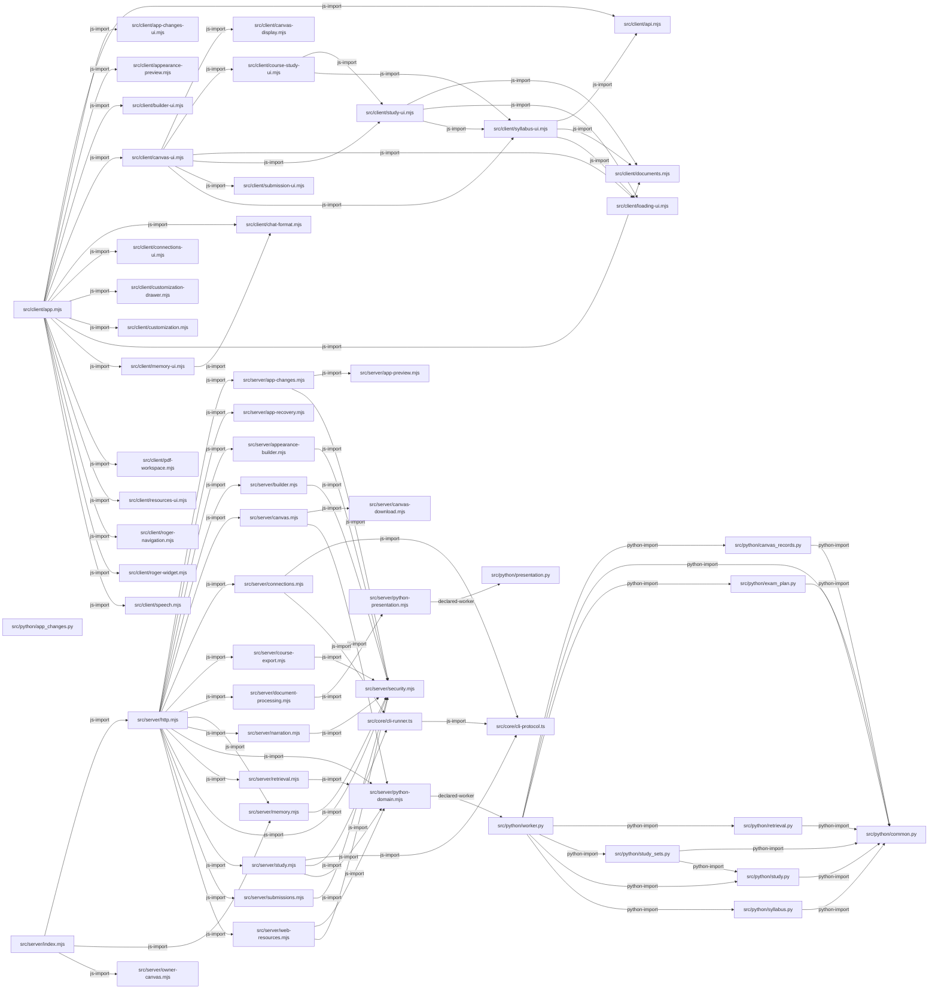

# Reader code relationships

[Open the interactive visual map](Explorer.html).

Generated by `npm run map`; refreshed automatically by normal checks/start.
Do not edit by hand. Edges show source dependencies and declared workers, not runtime data flow.

## Open source

- [src/client/api.mjs](../src/client/api.mjs)
- [src/client/app-changes-ui.mjs](../src/client/app-changes-ui.mjs)
- [src/client/app.mjs](../src/client/app.mjs)
- [src/client/appearance-preview.mjs](../src/client/appearance-preview.mjs)
- [src/client/builder-ui.mjs](../src/client/builder-ui.mjs)
- [src/client/canvas-display.mjs](../src/client/canvas-display.mjs)
- [src/client/canvas-ui.mjs](../src/client/canvas-ui.mjs)
- [src/client/chat-format.mjs](../src/client/chat-format.mjs)
- [src/client/connections-ui.mjs](../src/client/connections-ui.mjs)
- [src/client/course-study-ui.mjs](../src/client/course-study-ui.mjs)
- [src/client/customization-drawer.mjs](../src/client/customization-drawer.mjs)
- [src/client/customization.mjs](../src/client/customization.mjs)
- [src/client/documents.mjs](../src/client/documents.mjs)
- [src/client/loading-ui.mjs](../src/client/loading-ui.mjs)
- [src/client/memory-ui.mjs](../src/client/memory-ui.mjs)
- [src/client/pdf-workspace.mjs](../src/client/pdf-workspace.mjs)
- [src/client/resources-ui.mjs](../src/client/resources-ui.mjs)
- [src/client/roger-navigation.mjs](../src/client/roger-navigation.mjs)
- [src/client/roger-widget.mjs](../src/client/roger-widget.mjs)
- [src/client/speech.mjs](../src/client/speech.mjs)
- [src/client/study-ui.mjs](../src/client/study-ui.mjs)
- [src/client/submission-ui.mjs](../src/client/submission-ui.mjs)
- [src/client/syllabus-ui.mjs](../src/client/syllabus-ui.mjs)
- [src/core/cli-protocol.ts](../src/core/cli-protocol.ts)
- [src/core/cli-runner.ts](../src/core/cli-runner.ts)
- [src/python/app_changes.py](../src/python/app_changes.py)
- [src/python/canvas_records.py](../src/python/canvas_records.py)
- [src/python/common.py](../src/python/common.py)
- [src/python/exam_plan.py](../src/python/exam_plan.py)
- [src/python/presentation.py](../src/python/presentation.py)
- [src/python/retrieval.py](../src/python/retrieval.py)
- [src/python/study.py](../src/python/study.py)
- [src/python/study_sets.py](../src/python/study_sets.py)
- [src/python/syllabus.py](../src/python/syllabus.py)
- [src/python/worker.py](../src/python/worker.py)
- [src/server/app-changes.mjs](../src/server/app-changes.mjs)
- [src/server/app-preview.mjs](../src/server/app-preview.mjs)
- [src/server/app-recovery.mjs](../src/server/app-recovery.mjs)
- [src/server/appearance-builder.mjs](../src/server/appearance-builder.mjs)
- [src/server/builder.mjs](../src/server/builder.mjs)
- [src/server/canvas-download.mjs](../src/server/canvas-download.mjs)
- [src/server/canvas.mjs](../src/server/canvas.mjs)
- [src/server/connections.mjs](../src/server/connections.mjs)
- [src/server/course-export.mjs](../src/server/course-export.mjs)
- [src/server/document-processing.mjs](../src/server/document-processing.mjs)
- [src/server/http.mjs](../src/server/http.mjs)
- [src/server/index.mjs](../src/server/index.mjs)
- [src/server/memory.mjs](../src/server/memory.mjs)
- [src/server/narration.mjs](../src/server/narration.mjs)
- [src/server/owner-canvas.mjs](../src/server/owner-canvas.mjs)
- [src/server/python-domain.mjs](../src/server/python-domain.mjs)
- [src/server/python-presentation.mjs](../src/server/python-presentation.mjs)
- [src/server/retrieval.mjs](../src/server/retrieval.mjs)
- [src/server/security.mjs](../src/server/security.mjs)
- [src/server/study.mjs](../src/server/study.mjs)
- [src/server/submissions.mjs](../src/server/submissions.mjs)
- [src/server/web-resources.mjs](../src/server/web-resources.mjs)

## Import evidence

| Caller | Dependency | Source line |
|---|---|---|
| [src/client/app.mjs](../src/client/app.mjs) | src/client/api.mjs | 1 |
| [src/client/app.mjs](../src/client/app.mjs) | src/client/app-changes-ui.mjs | 19 |
| [src/client/app.mjs](../src/client/app.mjs) | src/client/appearance-preview.mjs | 21 |
| [src/client/app.mjs](../src/client/app.mjs) | src/client/builder-ui.mjs | 18 |
| [src/client/app.mjs](../src/client/app.mjs) | src/client/canvas-ui.mjs | 14 |
| [src/client/app.mjs](../src/client/app.mjs) | src/client/chat-format.mjs | 22 |
| [src/client/app.mjs](../src/client/app.mjs) | src/client/connections-ui.mjs | 17 |
| [src/client/app.mjs](../src/client/app.mjs) | src/client/customization-drawer.mjs | 20 |
| [src/client/app.mjs](../src/client/app.mjs) | src/client/customization.mjs | 15 |
| [src/client/app.mjs](../src/client/app.mjs) | src/client/documents.mjs | 3 |
| [src/client/app.mjs](../src/client/app.mjs) | src/client/memory-ui.mjs | 23 |
| [src/client/app.mjs](../src/client/app.mjs) | src/client/pdf-workspace.mjs | 2 |
| [src/client/app.mjs](../src/client/app.mjs) | src/client/resources-ui.mjs | 25 |
| [src/client/app.mjs](../src/client/app.mjs) | src/client/roger-navigation.mjs | 24 |
| [src/client/app.mjs](../src/client/app.mjs) | src/client/roger-widget.mjs | 16 |
| [src/client/app.mjs](../src/client/app.mjs) | src/client/speech.mjs | 4 |
| [src/client/canvas-ui.mjs](../src/client/canvas-ui.mjs) | src/client/canvas-display.mjs | 6 |
| [src/client/canvas-ui.mjs](../src/client/canvas-ui.mjs) | src/client/course-study-ui.mjs | 5 |
| [src/client/canvas-ui.mjs](../src/client/canvas-ui.mjs) | src/client/loading-ui.mjs | 4 |
| [src/client/canvas-ui.mjs](../src/client/canvas-ui.mjs) | src/client/study-ui.mjs | 3 |
| [src/client/canvas-ui.mjs](../src/client/canvas-ui.mjs) | src/client/submission-ui.mjs | 1 |
| [src/client/canvas-ui.mjs](../src/client/canvas-ui.mjs) | src/client/syllabus-ui.mjs | 2 |
| [src/client/course-study-ui.mjs](../src/client/course-study-ui.mjs) | src/client/study-ui.mjs | 1 |
| [src/client/course-study-ui.mjs](../src/client/course-study-ui.mjs) | src/client/syllabus-ui.mjs | 2 |
| [src/client/memory-ui.mjs](../src/client/memory-ui.mjs) | src/client/chat-format.mjs | 1 |
| [src/client/study-ui.mjs](../src/client/study-ui.mjs) | src/client/documents.mjs | 1 |
| [src/client/study-ui.mjs](../src/client/study-ui.mjs) | src/client/loading-ui.mjs | 2 |
| [src/client/study-ui.mjs](../src/client/study-ui.mjs) | src/client/syllabus-ui.mjs | 3 |
| [src/client/syllabus-ui.mjs](../src/client/syllabus-ui.mjs) | src/client/api.mjs | 1 |
| [src/client/syllabus-ui.mjs](../src/client/syllabus-ui.mjs) | src/client/documents.mjs | 2 |
| [src/client/syllabus-ui.mjs](../src/client/syllabus-ui.mjs) | src/client/loading-ui.mjs | 3 |
| [src/core/cli-runner.ts](../src/core/cli-runner.ts) | src/core/cli-protocol.ts | unknown; unsupported source language |
| [src/python/canvas_records.py](../src/python/canvas_records.py) | src/python/common.py | 6 |
| [src/python/exam_plan.py](../src/python/exam_plan.py) | src/python/common.py | 4 |
| [src/python/retrieval.py](../src/python/retrieval.py) | src/python/common.py | 6 |
| [src/python/study_sets.py](../src/python/study_sets.py) | src/python/common.py | 5 |
| [src/python/study_sets.py](../src/python/study_sets.py) | src/python/study.py | 6 |
| [src/python/study.py](../src/python/study.py) | src/python/common.py | 4 |
| [src/python/syllabus.py](../src/python/syllabus.py) | src/python/common.py | 11 |
| [src/python/worker.py](../src/python/worker.py) | src/python/canvas_records.py | 15 |
| [src/python/worker.py](../src/python/worker.py) | src/python/common.py | 11 |
| [src/python/worker.py](../src/python/worker.py) | src/python/exam_plan.py | 17 |
| [src/python/worker.py](../src/python/worker.py) | src/python/retrieval.py | 12 |
| [src/python/worker.py](../src/python/worker.py) | src/python/study_sets.py | 14 |
| [src/python/worker.py](../src/python/worker.py) | src/python/study.py | 13 |
| [src/python/worker.py](../src/python/worker.py) | src/python/syllabus.py | 16 |
| [src/server/app-changes.mjs](../src/server/app-changes.mjs) | src/server/app-preview.mjs | 8 |
| [src/server/app-changes.mjs](../src/server/app-changes.mjs) | src/server/security.mjs | 7 |
| [src/server/appearance-builder.mjs](../src/server/appearance-builder.mjs) | src/server/security.mjs | 1 |
| [src/server/builder.mjs](../src/server/builder.mjs) | src/server/security.mjs | 6 |
| [src/server/canvas.mjs](../src/server/canvas.mjs) | src/server/canvas-download.mjs | 2 |
| [src/server/canvas.mjs](../src/server/canvas.mjs) | src/server/python-domain.mjs | 3 |
| [src/server/connections.mjs](../src/server/connections.mjs) | src/core/cli-protocol.ts | 6 |
| [src/server/connections.mjs](../src/server/connections.mjs) | src/core/cli-runner.ts | 5 |
| [src/server/course-export.mjs](../src/server/course-export.mjs) | src/server/security.mjs | 2 |
| [src/server/document-processing.mjs](../src/server/document-processing.mjs) | src/server/python-presentation.mjs | 6 |
| [src/server/http.mjs](../src/server/http.mjs) | src/server/app-changes.mjs | 23 |
| [src/server/http.mjs](../src/server/http.mjs) | src/server/app-recovery.mjs | 24 |
| [src/server/http.mjs](../src/server/http.mjs) | src/server/appearance-builder.mjs | 25 |
| [src/server/http.mjs](../src/server/http.mjs) | src/server/builder.mjs | 22 |
| [src/server/http.mjs](../src/server/http.mjs) | src/server/canvas.mjs | 16 |
| [src/server/http.mjs](../src/server/http.mjs) | src/server/connections.mjs | 21 |
| [src/server/http.mjs](../src/server/http.mjs) | src/server/course-export.mjs | 28 |
| [src/server/http.mjs](../src/server/http.mjs) | src/server/document-processing.mjs | 14 |
| [src/server/http.mjs](../src/server/http.mjs) | src/server/memory.mjs | 27 |
| [src/server/http.mjs](../src/server/http.mjs) | src/server/narration.mjs | 20 |
| [src/server/http.mjs](../src/server/http.mjs) | src/server/python-domain.mjs | 19 |
| [src/server/http.mjs](../src/server/http.mjs) | src/server/retrieval.mjs | 18 |
| [src/server/http.mjs](../src/server/http.mjs) | src/server/security.mjs | 5 |
| [src/server/http.mjs](../src/server/http.mjs) | src/server/study.mjs | 17 |
| [src/server/http.mjs](../src/server/http.mjs) | src/server/submissions.mjs | 15 |
| [src/server/http.mjs](../src/server/http.mjs) | src/server/web-resources.mjs | 26 |
| [src/server/index.mjs](../src/server/index.mjs) | src/server/http.mjs | 1 |
| [src/server/index.mjs](../src/server/index.mjs) | src/server/memory.mjs | 2 |
| [src/server/index.mjs](../src/server/index.mjs) | src/server/owner-canvas.mjs | 3 |
| [src/server/memory.mjs](../src/server/memory.mjs) | src/server/security.mjs | 6 |
| [src/server/narration.mjs](../src/server/narration.mjs) | src/server/security.mjs | 7 |
| [src/server/python-domain.mjs](../src/server/python-domain.mjs) | src/python/worker.py | 5 |
| [src/server/python-presentation.mjs](../src/server/python-presentation.mjs) | src/python/presentation.py | 7 |
| [src/server/retrieval.mjs](../src/server/retrieval.mjs) | src/server/python-domain.mjs | 1 |
| [src/server/study.mjs](../src/server/study.mjs) | src/core/cli-protocol.ts | 3 |
| [src/server/study.mjs](../src/server/study.mjs) | src/core/cli-runner.ts | 2 |
| [src/server/study.mjs](../src/server/study.mjs) | src/server/python-domain.mjs | 1 |
| [src/server/submissions.mjs](../src/server/submissions.mjs) | src/server/security.mjs | 3 |
| [src/server/web-resources.mjs](../src/server/web-resources.mjs) | src/server/python-domain.mjs | 2 |
| [src/server/web-resources.mjs](../src/server/web-resources.mjs) | src/server/security.mjs | 1 |

The JSON includes exact source hashes, dependency-lock and producer identity, reverse importers, external import syntax and explicit dynamic/unsupported unknowns.
